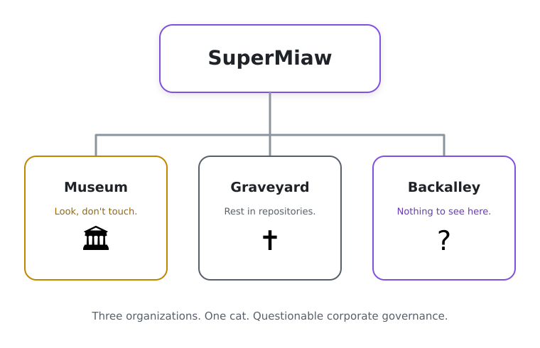

Not every project deserves the same fate.

Some are worth showcasing. Others are better left undisturbed. And a few require... special attention.

## The ecosystem

- 🏛️ **[Museum](https://github.com/supermiaw-museum)**: Projects worth keeping in the spotlight, regardless of their age.
- 🪦 **[Graveyard](https://github.com/supermiaw-graveyard)**: Abandoned projects, safely buried. Resurrection is not entirely ruled out.
- 🌑 **[Backalley](https://github.com/supermiaw-backalley)**: Some repositories need a little help before appearing in public.

---

Part-time employee at [FewFewSoft](https://github.com/FewFewSoft).
